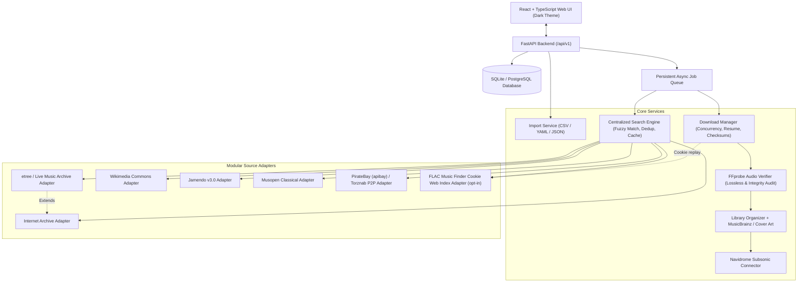

# OpenMusic Archive Manager — System Architecture

## 1. Overview

**OpenMusic Archive Manager** is a modular, self-hosted music discovery, verification, download, and library organization web application designed for seamless integration with **Navidrome** and NAS storage environments.

---

## 2. Core Architectural Principles

1. **Strict Source Adapter Modularity**:
   - Every external archive implements `BaseSourceAdapter` (`backend/app/adapters/base.py`).
   - Adding a new music archive requires only creating a subclass and registering it in the Adapter Registry (`backend/app/adapters/registry.py`).
   - `EtreeAdapter` extends `InternetArchiveAdapter` directly to reuse HTTP transport, metadata parsing, and file extraction without duplicating code.

2. **Explicit User Approval Gate**:
   - Searches and imports **never** trigger automatic downloads.
   - Users inspect normalized releases, compare duplicates across sources, view individual track listings, bit depth, sample rate, file sizes, and licenses, and explicitly queue selected albums or tracks.

3. **Persistent Asynchronous Jobs**:
   - Search jobs and download tasks are stored in SQLite/PostgreSQL (`search_jobs`, `download_jobs`).
   - On container startup, interrupted jobs are recovered automatically so active queues survive container restarts.

4. **True Lossless Verification (`ffprobe`)**:
   - Downloaded audio files are inspected with `ffprobe` to verify actual codec (`flac`, `pcm_s16le`, `pcm_s24le`, `alac`), sample rate, bit depth, channel count, and duration.
   - Suspicious files (e.g., `.flac` extension wrapping an MP3/AAC stream, truncated streams, missing metadata, or transcode artifacts) are flagged with warnings and never silently re-encoded.

5. **NAS & Navidrome Compatibility**:
   - Organizes verified tracks into `/music/{Artist}/{Album (Year)}/{TrackNum} - {Title}.{ext}` with `cover.jpg`.
   - Embeds MusicBrainz tags where enabled and triggers Navidrome's Subsonic `/rest/startScan` endpoint upon completion.

6. **Opt-In Credentialed (Cookie-Replay) Sources**:
   - `FlacMusicFinderAdapter` reaches an HTML web index that sits behind a bot challenge. It replays a session cookie that the operator exported from their own browser; the challenge is **detected** (via `_CHALLENGE_MARKERS` and "logged out" page markers) and reported as an actionable error — it is never solved or bypassed.
   - The source is disabled by default and the cookie lives in `SECRET_KEYS`, so it is masked on every read endpoint.
   - Two runtime guards keep the credential contained: `cookie_strip_hook` deletes the cookie from any request that leaves the site's own host (used both while searching and while downloading), and hosts taken from the site's file links are added to the download allow list only while the source is enabled (`flacmusicfinder_download_hosts`).
