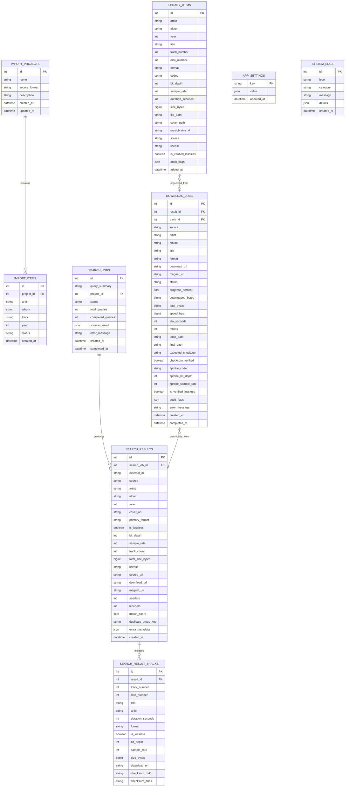

# Database Schema

OpenMusic Archive Manager uses **SQLAlchemy 2.0 ORM** and supports **SQLite** (default, stored in `/app/config/openmusic.db` with WAL mode enabled) and **PostgreSQL** (via `DATABASE_URL`).

